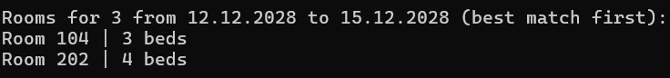
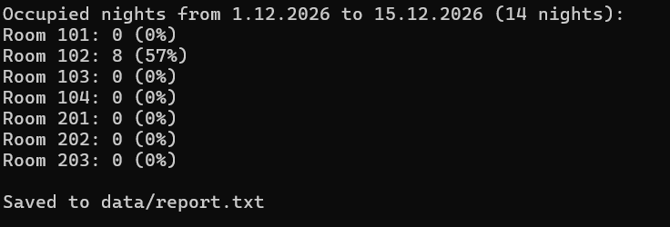

# Hotel Management

Console hotel reservation system in C++. It can be used to register guests, find free rooms for a group, release reservations and create reports for a certain period. All text is handled by a custom `MyString` class instead of `std::string`.

## Features

- Register a guest in a room with arrival and departure date, name and an optional note.
- Rooms can have many reservations, as long as they do not overlap. The departure day is free for the next guest.
- Show all free rooms in a period.
- Find rooms for a number of guests in a period, with the smallest room that fits at the top.
- Release a reservation (check out or cancel), chosen from a numbered list.
- Close a room for repair or cleaning. That way no guest can be registered in it. Later it can be opened.
- Report: shows and saves to a file the occupied nights and the percentage for every room in a certain period.
- Every value is checked as soon as it is entered.
- Type `/back` at any prompt to return to the menu.

## Example





## Building and running

Requires a compiler with C++17 support. The program clears the console with `cls`, so it is meant for Windows.

**Visual Studio:** open `HotelManagement.slnx` and press `Ctrl+F5`.

**g++:** run these in the project folder:

```bash
g++ -std=c++17 src/*.cpp -o hotel.exe
.\hotel.exe
```
Run the program from the project folder, because it reads and writes its files in `data/`.

## Project structure

```
src/
    main.cpp            entry point
    Interface           main menu
    MyString            hand-written string class: copying and moving, +=, comparison, input and output
    Input               reading lines, numbers and text with /back option
    Date                input, validation and calculation of the number of days between two dates
    Room                one room: number, beds, closed or open
    Reservation         one stay: room, dates, guest and note, and overlap check
    Collection          loading and saving rooms and reservations, finding free rooms
    Registration    \
    Available_rooms |
    Find_room       |
    Release         | - inherit class for menu option
    Report          |
    Close_room      /
data/
    rooms.txt           the rooms of the hotel
    reservations.txt    the saved reservations
```

## File formats

- `rooms.txt` lists one room per line: `number/beds/closed`, where `closed` is `1` for a closed room and `0` for an open one
- `reservations.txt` lists one reservation per line: `room/arrival date/departure date/guest/note` with dates as `day.month.year`
- `report.txt` lists one room per line with its occupied nights and percentage for a certain period

## Possible improvements

- Prices for every room type and period, and the total price of a reservation.
- Store the data in an SQL database instead of text files.
